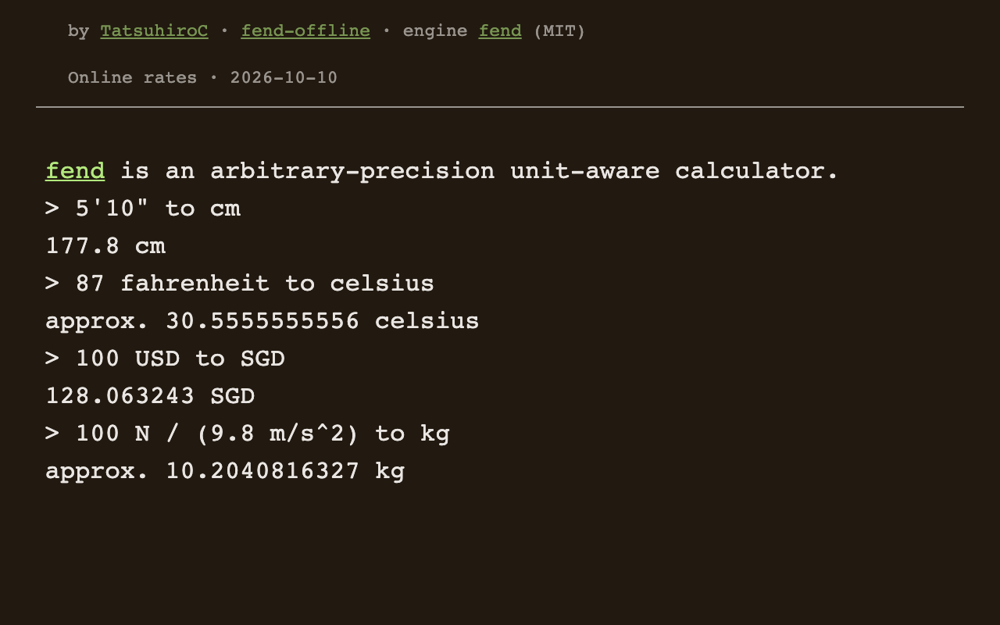

  
  <h1>fend offline</h1>
  
Write calculations, units and currency conversions in one line.

  
Open it in your browser. Keep using it offline.

  

    
    
  

  

    
    · <a href="README.md">简体中文</a> · English
  

## Features

- **Write expressions**: arbitrary-precision numbers, fractions, complex numbers, trigonometry and number bases.
- **Calculate with units**: convert lengths, masses, temperatures, speeds and more, with a preview as you type.
- **Use it anywhere**: open the website, add it to your home screen, or install the Android APK.

## Try it

| Calculation | Input |
| --- | --- |
| Feet and inches to centimetres | `5'10" to cm` |
| Fahrenheit to Celsius | `87 fahrenheit to celsius` |
| US dollars to Singapore dollars | `100 USD to SGD` |
| Mass from force and acceleration | `100 N / (9.8 m/s^2) to kg` |
| Hexadecimal to decimal | `0xff to decimal` |

Press **Enter** to calculate. See the [fend documentation](https://printfn.github.io/fend/documentation/) for more syntax.

## Get started

| Device | How to use it |
| --- | --- |
| Computer | [Open the website](https://tatsuhiroc.github.io/fend-offline/) in Chrome and click **Install** to install the web app. Use it offline after the first load and completed caching. |
| iPhone / iPad | Open it in Safari, then choose **Share → Add to Home Screen**. |
| Android | [Download the latest APK](https://github.com/TatsuhiroC/fend-offline/releases/latest), or install the web app from your browser menu. |

The website works offline after its first online load and completed caching. The APK includes its calculator resources. Tap the PWA update prompt when it appears; install a newer APK over the previous release to update the Android app.

## Exchange rates

Submitting a currency conversion first requests the latest online rates. If the request fails or you are offline, it uses the last saved rates, then the bundled backup if no saved data exists. The header shows the **source and data date**.

The source updates daily, rather than providing live trading quotes. Offline data can be stale, and existing monetary variables may retain their assignment-time rate. Enter the amount directly to use the data fetched for that conversion. See [usage and common questions](docs/USAGE.md#english-summary).

---

[Usage and common questions](docs/USAGE.md#english-summary) · [Development and maintenance](docs/DEVELOPMENT.md#english-quick-start) · [Report an issue](https://github.com/TatsuhiroC/fend-offline/issues)

Powered by [printfn/fend](https://github.com/printfn/fend) (Rust / WebAssembly, MIT). Maintained by [TatsuhiroC](https://github.com/TatsuhiroC), with offline caching, online rates and Android packaging. See [THIRD_PARTY_NOTICES.txt](THIRD_PARTY_NOTICES.txt) for bundled licenses.
